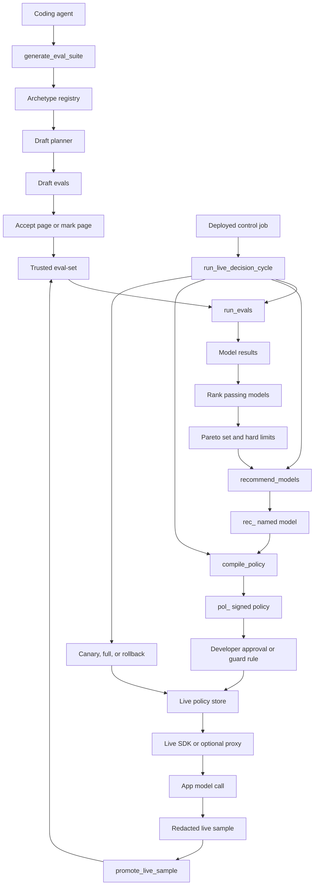

# OpenEval

OpenEval helps an AI coding agent choose a model for one AI feature.

It is an agent tool and an HTTP API.
The agent calls it with repo context, prompts, schemas, examples, failures, and notes.
OpenEval makes draft evals from that evidence.
It runs trusted evals against models.
It recommends one named model for the app.

OpenEval can also serve a live signed policy.
The app uses that policy through the SDK or optional proxy.
A deployed control job can update that policy in guarded mode.

The repository has two tools:

- **OpenEval** is the referee. It names the cheapest fast setup that passes your trusted evals.
  A setup is a model, its settings, and an optional system prompt.
- **openeval-tune** is the player. It changes one thing in each round on a branch:
  the prompt, the tool descriptions, the harness code, or the settings.
  OpenEval scores each change on held-out evals that openeval-tune cannot see.
  See [packages/openeval-tune](packages/openeval-tune/README.md).

## Who it is for

OpenEval is for teams that add AI features to real products.

It is useful when:

- A coding agent writes or changes an AI feature.
- A developer needs evidence before a model change.
- A team wants a cheaper or faster model that still passes evals.
- A team wants human review for subjective evals.
- A team wants safe live model updates with clear guard rules.

It is not an eval dashboard.
It is not a prompt rewrite system.
It is not a learned per-request picker.
It does not trust a model judge until the judge agrees with human marks.

## Main idea

An **eval** is one product check on one example.
The input goes in.
A score says if the model did the job.

An **archetype** is an eval pattern.
It tells the agent what evidence to give.
It tells OpenEval which scorer primitive can apply.

A **scorer primitive** is a small program check.
It returns pass or fail for one model output.

A **named model** is the model id that the app will use.
The coding agent writes that model id into the app config.

A **policy** is a signed live config.
It names the primary model, backups, and limits.

A **Pareto set** is a short model list.
In that list, no model loses to another model on quality, time, and cost at once.

## Architecture



## What it does

### 1. Draft evals

Call `generate_eval_suite`.

The input can include:

- `description`
- `system_prompt`
- `tools` and `tool_choice`
- `sample_files`
- `labeled_examples`
- `what_good_means`
- `archetype_ids`
- `custom_archetypes`
- `evidence`

OpenEval selects archetypes from explicit ids first.
Then it uses evidence and description.
It uses schemas and labels before keyword guesses.
It returns `JOB_UNCLEAR` when it cannot draft a useful eval.

### 2. Route trust

A deterministic program check can become trusted after accept.
A person eval needs marks.
A model-only check never becomes trusted.

Program checks include `json_schema`, `regex_match`, `numeric_close`, `set_equals`,
`contains_all`, `contains_any`, `length_range`, `tool_args`, `trace_rule`,
`citation_support`, `retrieval_contains`, and `pairwise_equals`.

A person eval can use a model judge for new outputs.
Call `configure_judge`, then `calibrate_judge`.
The judge becomes trusted only when it agrees with human marks on held-out examples:
20 or more examples, 85 percent accuracy or more, and a kappa of 0.6 or more.
New human marks make the judge stale. Calibrate it again.
Without a trusted judge, a person eval on a new output shows as "not graded". It does not pass in silence.

OpenEval stores eval-set versions.
New work can copy old evals forward.
A registered failure can become a new eval.

### 3. Run models

Call `run_evals`.

OpenEval runs trusted evals under a spend cap.
It scores code evals with scorer primitives or fixtures.
It reuses person marks from the eval-set version.

Pass `models` (model ids) or `candidates`.
A candidate is `{ id, model, settings?, system_prompt? }`. The id is the model id or `model#label`.

### Tool calls

A job can give the model tools.
Pass `tools` to `generate_eval_suite`: `[{ name, description?, parameters? }]`. `parameters` is a JSON schema.
`tool_choice` is `auto`, `required`, `none`, or `{ "name": "<tool>" }`.
When `tools` is not set, OpenEval uses `evidence.tool_schemas` that have a valid name.

Each run sends the tools to the model as native function tools.
When the model calls a tool, the scored output is JSON:

```json
{ "content": null, "tool_calls": [{ "name": "search_orders", "arguments": { "order_id": "8831" } }] }
```

A labeled example can state the expected call in place of `expected`:

```json
{ "text": "Where is order 8831?", "label": "Search",
  "expected_tool_call": { "name": "search_orders", "args": { "order_id": "8831" } } }
```

Use `{ "none": true }` when the model must not call a tool.
Each example becomes a `tool_args` program check.
`tool_args` finds the call with the expected name, then checks `args` and `required`.
A default model list skips models that the catalog marks as without tool calling.
OpenEval sends one turn. It does not run the tool or send the tool result back to the model.

Each eval runs 3 times per candidate by default (`reps`, 1 to 10).
An eval passes only when every scored rep passes.
The report shows a pass rate with a 95 percent range and the flaky evals.
A recheck uses the reps of the run that named the model, so the scoring stays the same.

Cost is the real cost from the provider, with token counts.
A failed call is retried. A call that still fails is an error. It is not a model fail.

### 4. Recommend a model

Call `recommend_models`.

OpenEval applies hard limits.
It ranks models that pass all trusted evals.
It chooses the cheapest fast passing model.
A costlier or slower model wins only with clear quality lift.

### 5. Serve live policy

Call `compile_policy`.

OpenEval creates a signed policy from the recommendation.
Approval controls when live traffic can use that policy.
The app reads the policy through the SDK or optional proxy.

### 6. Update live policy in guarded mode

Call `configure_live_automation`.

A deployed control job can call `run_live_decision_cycle`.
The cycle checks approved guard rules.
It can publish a 5 percent canary.
It can promote a canary to full.
It can roll back to the last full policy.

Rollback has priority over promotion.
Manual mode never changes live policy.

#### How a canary is judged

The SDK and proxy keep live numbers for each policy.
They send the change since the last report, so many app servers add up.
The cycle compares the canary with the full policy over the same recent window.
The window starts when the canary started and is never longer than `stats_window_s`.

The numbers are:

- **Errors:** requests where no model answered.
- **Fallbacks:** requests where a backup answered.
- **Misses:** answers the app reported with `reportMiss`.
- **Quality:** answers that failed a live check, plus `reportQuality` results.
- **Latency** and **cost** per answer. Cost counts only when the provider reports it.

Live checks come from the trusted evals.
`compile_policy` copies program checks from `output_contract` and `safety_policy` evals
into the signed policy when the check fits any answer:
`json_valid`, `json_schema`, `must_not_contain`, and `length_range`.
The SDK and proxy run them on every answer.
The app can add its own with the SDK option `liveChecks`.

The canary rolls back when one of these is true:

- A rate is over its limit: `max_error_rate`, `max_fallback_rate`, `max_miss_rate`, `max_quality_fail_rate`.
- A rate is worse than the full policy by more than `max_rate_increase`, and the gap is clear at 95 percent.
- Average latency or cost is higher than the full policy by more than `max_latency_increase` or `max_cost_increase`.

No rule acts until the canary has `min_rollback_requests` requests.
A canary goes to full only when it is healthy, is at least `min_canary_age_s` old,
and has `min_canary_requests` requests of its own.
An unhealthy canary is never promoted, even with `auto_rollback` off.

| Guard rule | Default |
| --- | --- |
| `max_error_rate` | 0.02 |
| `max_fallback_rate` | 0.05 |
| `max_miss_rate` | 0.01 |
| `max_quality_fail_rate` | 0.05 |
| `max_rate_increase` | 0.02 |
| `max_latency_increase` | 0.5 |
| `max_cost_increase` | 0.5 |
| `min_rollback_requests` | 20 |
| `min_canary_requests` | 200 |
| `min_canary_age_s` | 1800 |
| `stats_window_s` | 86400 |

`get_live_report` shows the canary and full policy numbers in `canary_evidence`.

The policy holds the full winning setup for the primary and each backup:
the base model, the settings, and the system prompt.
The SDK and proxy send the base model id with those settings.
The system prompt is sent only when the app opts in:
`applyPolicySystemPrompt: true` in the SDK, or the header `x-openeval-apply-system-prompt: true` on the proxy.
A recommendation from app harness outputs cannot become a live policy.

### 7. Tune a feature with openeval-tune

openeval-tune runs a hill-climb loop against OpenEval.

Each eval set has a stable hidden held-out split.
These tools support the loop:

- `get_eval_inputs` returns the eval inputs, so your own harness can make the outputs.
- `submit_outputs` scores those outputs. Use it for prompt, tool, and harness changes.
- `get_training_failures` shows failures on the training split only.
- `get_verdict` compares a candidate with the baseline.
  It returns `keep`, `revert_overfit`, `revert_regressed`, `within_noise`, or `not_comparable`.
  It reports a plateau after 3 rounds with no gain.

The loop uses an **optimizer key** (`oeo_...`).
A person with a full key mints it: `POST /v1/keys {"project_id":"prj_...","scope":"optimizer"}`.
The server limits that key to the six tools above.
Every response hides the held-out evals.
The key cannot configure or calibrate the judge, and it cannot change live policy.

`openeval-tune promote` can ship a winning direct setup through Live.
It needs a full key, and a person approves each gate.

## Built-in archetypes

The V1 registry includes these archetypes:

- `output_contract`
- `extraction_transform`
- `classification_route`
- `tool_call`
- `tool_result_use`
- `rag_retrieval`
- `grounded_answer`
- `citation_quality`
- `math_exact`
- `code_functional`
- `conversation_task`
- `agent_trajectory`
- `safety_policy`
- `fairness_invariance`
- `cost_latency_fit`

Use `custom:<slug>` for a project archetype.
The coding agent must pass its definition in `custom_archetypes`.

## How to run locally

Use Node.js 22 or newer.
The repository includes `.nvmrc`.

```bash
npm ci
OPENEVAL_KEY=replace-with-a-local-secret npm start
```

Optional environment variables:

```bash
OPENEVAL_SQLITE=./openeval.sqlite
OPENEVAL_BASE_URL=http://127.0.0.1:3000
PORT=3000
```

Run checks:

```bash
npm test
npm run test:tune
npm run build
```

If `better-sqlite3` reports a Node.js module version mismatch, rebuild it.

```bash
npm rebuild better-sqlite3
```

## How to use with an agent

Add the MCP server config from `examples/mcp.json`.

The same JSON works over MCP and HTTP.
HTTP uses this route:

```text
POST /v1/tools/{tool_name}
```

Each mutating tool needs `idempotency_key`.
Each tool returns `next_action`.
The agent must follow `next_action`.

## Basic flow

1. Call `generate_eval_suite`.
2. Open the `accept_url`.
3. Accept deterministic program checks.
4. Queue person marks when needed.
5. Call `run_evals` with a spend cap.
6. Call `get_eval_report`.
7. Call `recommend_models`.
8. Write the named model into app config.

## Live flow

1. Call `compile_policy` from a recommendation.
2. Approve the signed policy.
3. Use the SDK or optional proxy in the app.
4. Call `get_live_report` to inspect live state.
5. Promote safe live samples into evals when needed.
6. Configure guarded automation when the team wants auto update.
7. Run `run_live_decision_cycle` from a deployed control job.

## Example eval request

```json
{
  "description": "Return JSON for a support route.",
  "archetype_ids": ["output_contract", "classification_route"],
  "evidence": {
    "schemas": [
      {
        "fields": ["label", "reason"]
      }
    ],
    "labels": ["billing", "technical", "sales"]
  },
  "idempotency_key": "suite-001"
}
```

## Safety boundaries

OpenEval does not secretly author trusted evals.
The coding agent drafts evals from evidence.
A person accepts or marks the evals.

OpenEval does not sit in front of live traffic by default.
The SDK path is the default live path.
The optional proxy uses the same signed policy engine.

OpenEval does not run evals on a live user request.
Live samples are redacted before storage.

The optimizer never sees held-out evals and never grades itself.
The server enforces this, not the optimizer.

## Why use it

OpenEval makes model choice evidence-based.
It reduces brittle eval generation.
It keeps subjective judgment with people.
It keeps live model changes inside guard rules.
It gives the app one named model or one signed policy.
It gives the team a report that fits in agent context.

## Contribute

Read [CONTRIBUTING.md](CONTRIBUTING.md) before you open a pull request.
Report suspected vulnerabilities with [SECURITY.md](SECURITY.md).

## License

OpenEval uses the Apache License 2.0.
See [LICENSE](LICENSE) and [NOTICE](NOTICE).
